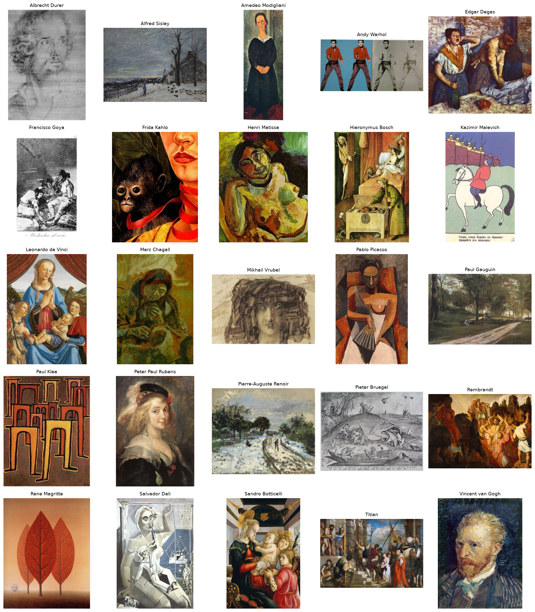
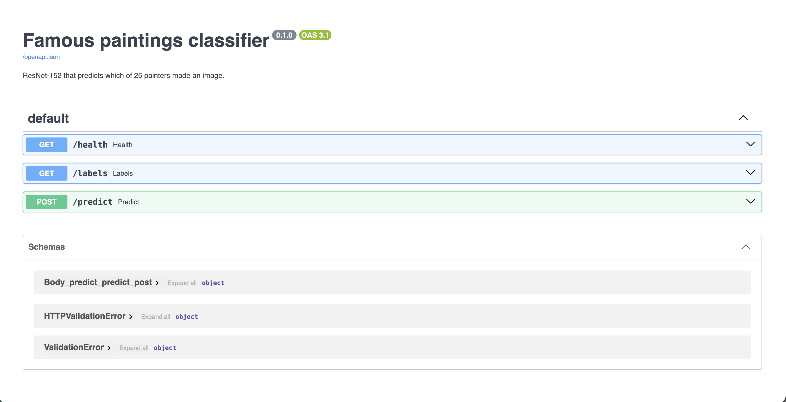

# Famous paintings classification

A ResNet-152 that looks at a painting and predicts which of 25 painters made it.

The model used for inference is `models/resnet152_progressive.pth`. On the course test set of 300 images it is correct on **274** of them (**91.3%**).

The dataset comes from the Quera deep-learning course and is not stored in this repository. Training images live in numbered folders under `data/`. Test images live in `test_data/`. Checkpoints live in `models/`. All three paths are gitignored because of their size.

## Dataset sample

One painting from each of the 25 painters. The images used to make this figure live in `presentation/dataset_sample.png`.



## Painters

| id | painter | id | painter |
|---:|---|---:|---|
| 0 | Albrecht Durer | 13 | Pablo Picasso |
| 1 | Alfred Sisley | 14 | Paul Gauguin |
| 2 | Amedeo Modigliani | 15 | Paul Klee |
| 3 | Andy Warhol | 16 | Peter Paul Rubens |
| 4 | Edgar Degas | 17 | Pierre-Auguste Renoir |
| 5 | Francisco Goya | 18 | Pieter Bruegel |
| 6 | Frida Kahlo | 19 | Rembrandt |
| 7 | Henri Matisse | 20 | Rene Magritte |
| 8 | Hieronymus Bosch | 21 | Salvador Dali |
| 9 | Kazimir Malevich | 22 | Sandro Botticelli |
| 10 | Leonardo da Vinci | 23 | Titian |
| 11 | Marc Chagall | 24 | Vincent van Gogh |
| 12 | Mikhail Vrubel | | |

The class index is the folder number. It is also the alphabetical order of the filename prefix (`Vincent_van_Gogh_12.jpg` belongs to class 24).

## Project layout

```text
config/
  train.yaml          training hyperparameters
  infer.yaml          checkpoint used for prediction
src/
  train.py            fine-tune ResNet-152
  predict.py          classify every image in a folder
  data.py
  model.py
app/                  FastAPI service
experiments/          notebooks
presentation/         README figures
models/               checkpoints, not committed
data/                 numbered class folders, not committed
```

## Setup

Put the trained file at:

```text
models/resnet152_progressive.pth
```

The API refuses to start if that file is missing. Override the path with `MODEL_PATH` if the checkpoint lives somewhere else. The folder command reads `config/infer.yaml`.

### pip and venv

```bash
python -m venv .venv
source .venv/bin/activate
pip install -r requirements.txt
```

### conda

```bash
conda env create -f environment.yml
conda activate paintings
```

`environment.yml` installs Python 3.11 and the scientific packages from conda-forge, then installs PyTorch, torchvision, and FastAPI with pip.

### uv

```bash
uv sync
source .venv/bin/activate
```

`pyproject.toml` is the uv project file. `uv sync` creates `.venv` and installs the same libraries.

## Train

Edit `config/train.yaml`, then from the repository root:

```bash
python -m src.train
```

This builds a stratified 80/20 split, applies the geometric augmentation, and fine-tunes every ResNet-152 parameter. The best validation-accuracy weights are written to the `output` path in that config. The default output is `models/resnet152_finetuned.pth`, so it does not overwrite `models/resnet152_progressive.pth`.

## Predict a folder

```bash
python -m src.predict test_data
python -m src.predict test_data --output predictions.csv
```

The command walks the folder, including nested directories, and prints `file`, `artist`, and `confidence` for each image. `--checkpoint` overrides `config/infer.yaml`.

## Run the API

From the repository root:

```bash
uvicorn app.main:app --host 0.0.0.0 --port 8000
```

Open `http://127.0.0.1:8000/docs` for the interactive page.



Health check:

```bash
curl http://127.0.0.1:8000/health
```

Predict a painting. The response includes the top class and the next most likely painters.

```bash
curl -F "file=@test_data/test_0.jpg" "http://127.0.0.1:8000/predict?top_k=5"
```

Example response:

```json
{
  "prediction": {
    "artist": "Leonardo_da_Vinci",
    "artist_id": 10,
    "confidence": 0.98
  },
  "top": []
}
```

`GET /labels` returns the 25 class names in index order.

The server loads the network once, in evaluation mode, and uses CUDA, Apple MPS, or CPU, in that order. Input images are resized to 248, center-cropped to 224, and normalized with ImageNet mean and standard deviation. That is the same validation transform used during training. Color is not changed.

## Notebooks

| notebook | what it does |
|---|---|
| `experiments/artist.ipynb` | Course notebook. Builds the test submission and compares it with the true labels. |
| `experiments/code1.ipynb` | First fine-tunes of ResNet-18, ResNet-34, and ResNet-152. Classifier only, no augmentation. |
| `experiments/code2.ipynb` | Geometric augmentation and progressive fine-tuning that produced `resnet152_progressive.pth`. |
| `experiments/code3.ipynb` | Validation accuracy, confusion matrix, and the confident-error analysis. |
| `experiments/colab.ipynb` | Colab version: stratified split, three ResNets, checkpoints saved to Google Drive. |

`report.md` is the full record of these experiments.

## Dataset

Download the course archive on Colab or locally:

```bash
pip install gdown
gdown 1-0d315aj7Ai8NNqat65XDvaOcHDcHiUD
unzip famous_paintings.zip
```

The zip stores every training image directly in `data/`, with names like `Pablo_Picasso_206.jpg`. `colab.ipynb` moves each file into `data/<class_id>/`. The local `data/` folder in this project is already in that layout. Test images stay as `test_data/test_0.jpg` through `test_data/test_299.jpg`.

There are 6,516 labeled training images. The largest classes are Vincent van Gogh (877) and Edgar Degas (702). The smallest are Frida Kahlo (120) and Kazimir Malevich (126).

## Publishing notes

GitHub rejects files over 100 MB, and this checkpoint is about 230 MB, so the weights are not part of the git history. Share `models/resnet152_progressive.pth` with Git LFS or a release asset, and keep `data/` and `test_data/` out of the repository.
